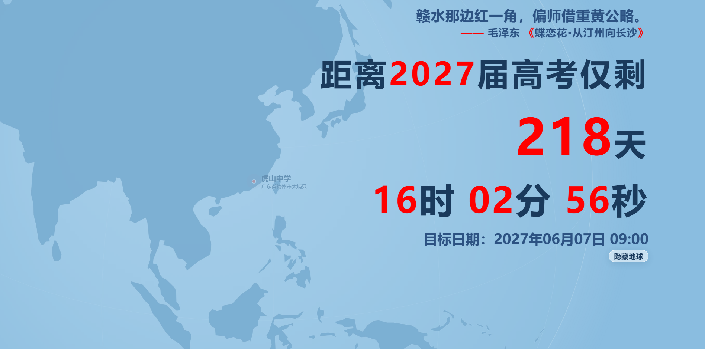

# 高考倒计时壁纸 · 2027

> 作者：**ouroooo** · 仓库：https://github.com/ouroooo/gaokao-countdown

一个可以离线运行的高考倒计时网页 / 动态桌面壁纸：**地球定位开场 + 毛泽东诗词轮播 + 高考倒计时**。

纯静态 HTML，无 npm、无构建、无任何外部网络请求。直接双击 `index.html` 就能用，也可以部署到 GitHub Pages 作为在线壁纸。



**当前版本：v1.0.0**（基于 v4-se：预渲染静帧 + 空闲零重绘）

---

## 功能

- 倒数到 **2027-06-07 09:00**；过了会自动滚到下一年的 6 月 7 日
- 79 首毛泽东诗词：一首读完才换下一首，同首诗内按原作顺序逐句显示
- 9 月 9 日、12 月 26 日两个纪念日全屏纪念文字
- 开场地球自转 → 放大定位到目标地点 → 约 5 秒后变浅
- 变浅后可用按钮隐藏 / 显示地球；拖动地球可旋转
- 默认坐标下静止后切换为预渲染静帧并**停止重绘**，空闲 CPU 占用接近 0
- 横屏 / 竖屏自适应

---

## 快速开始

1. 下载本仓库（Code → Download ZIP，或 git clone）
2. 双击 `index.html`
3. 想当桌面壁纸：用 [Lively Wallpaper](https://www.rocksdanister.com/lively/) 添加这个 HTML 文件

不需要安装任何东西，也不需要启动服务器。

---

## 改成你的学校（重点）

默认坐标是**广东省梅州市大埔县虎山中学**。如果你不在那里，只需要改 `index.html` 里的 4 个值。

### 1. 找到配置块

用任意文本编辑器打开 `index.html`，搜索 `用户配置`，会看到：

```js
// ==================== 用户配置（改这里） ====================
// 目标地点：经度、纬度（十进制度；东经/北纬为正，西经/南纬为负）
var TARGET_LON = 116.694;   // 经度
var TARGET_LAT = 24.352;    // 纬度
var TARGET_NAME = '虎山中学';           // 主标签
var TARGET_SUB = '广东省梅州市大埔县';   // 副标签

// earth-still.webp 预渲染时的中心坐标（一般不用改）。
// 改过 TARGET_LON / TARGET_LAT 后，页面会自动退回“冻结画面”，位置仍然正确。
var STILL_LON = 116.694;
var STILL_LAT = 24.352;
// ==========================================================
```

### 2. 填经纬度

- `TARGET_LON` = **经度**（东西方向，东经为正、西经为负）
- `TARGET_LAT` = **纬度**（南北方向，北纬为正、南纬为负）
- 用**十进制度**，不是度分秒；不要写 `°`、`E`、`N` 这些符号
- **先经度、后纬度**，不要填反

示例：

| 地点 | TARGET_LON | TARGET_LAT |
|---|---:|---:|
| 北京天安门 | `116.3975` | `39.9087` |
| 上海外滩 | `121.4900` | `31.2400` |
| 广州塔 | `113.3245` | `23.1066` |
| 悉尼 | `151.2093` | `-33.8688` |

### 3. 改标签

- `TARGET_NAME`：定位点旁的主标题，建议 **不超过 6 个字**
- `TARGET_SUB`：副标题，建议 **不超过 14 个字**

太长会超出屏幕，尤其是竖屏。

### 4. 保存并刷新

保存 `index.html`，重新打开页面。开场仍然是“地球 → 你的地点”，目标点会出现在地球中心。

### 坐标从哪里来

- **Google 地图**：在目标位置右键 → 点最上面的坐标即可复制。注意 Google 显示的顺序是 **纬度, 经度**，填进代码时要反过来。
- **OpenStreetMap**：右键 → “显示地址”，或用坐标拾取网站；OSM 是 WGS-84，和本页面的坐标系一致。
- **高德 / 百度**：坐标拾取器给的是 GCJ-02 / BD-09，和 WGS-84 有几百米偏移。只做城市级定位完全够用；要精确到校门，建议用 OSM / Google，或先做坐标转换。
- 任意来源都可以，关键是：**十进制度、先经度后纬度、东/北为正**。

### 改了坐标，`earth-still.webp` 怎么办？

`earth-still.webp` 是按**默认坐标（虎山中学）**预渲染的一张地球静帧，用来在动画结束后停止重绘。

你改坐标后，页面会自动检测到 `TARGET_*` 与 `STILL_*` 不一致，然后：

- **不再加载**这张旧静帧；
- 在开场结束后**冻结当前实时画面**，坐标仍然正确；
- 空闲时同样不重绘，只是少了“定位点脉冲”和预渲染图的锐度。

所以：**只改坐标、不改图，也能正常使用。** 这是默认行为，不需要额外设置。

如果你希望保留“脉冲定位点 + 预渲染静帧”，才需要重新生成静帧：

1. 用与页面相同的正交投影、目标朝向，在 3072×3072 的透明画布上渲染地球（球半径 1300，含光晕留白，不含文字/标记）；
2. 导出 WebP，替换 `earth-still.webp`；
3. 把 `STILL_LON` / `STILL_LAT` 改成和 `TARGET_LON` / `TARGET_LAT` 相同。

> 不做这一步完全没问题。静帧只是性能优化，回退后的冻结画面同样不会持续重绘。

也可以直接删除 `earth-still.webp`：默认坐标会退回冻结画面，其他坐标不受影响。

---

## 改倒计时日期

搜索 `targetYear = 2027` 和 `new Date(targetYear, 5, 7, 9, 0, 0)`。

```js
var targetYear = 2027;
var targetDate = new Date(targetYear, 5, 7, 9, 0, 0);  // 月份 0 基：5 = 6 月
```

- 月份是 **0 基**：`5` 表示 6 月，`6` 表示 7 月。
- 当前逻辑会在目标时间过去后自动滚到下一年；如果不想滚动，改 `while (targetDate <= now)` 那段。

---

## 改诗词

搜索 `const poems = [`，数据格式：

```js
{ t: '沁园春·长沙', v: [
  '独立寒秋，湘江北去，橘子洲头。',
  '看万山红遍，层林尽染；漫江碧透，百舸争流。',
  // ...
]},
```

- `t` 是诗题，`v` 是按原作顺序排列的句子。
- **不要打乱同一首诗的句子顺序**；一首读完后才会随机换下一首。
- 纪念日在 `getSpecialText` 里改；9/9 和 12/26 的文案是写死的。
- 每句停留时间：搜索 `POEM_INTERVAL_MS`（默认 7000 毫秒）。

---

## 文件结构

```
gaokao-countdown/
├── index.html          # 整个应用（HTML + CSS + JS + 诗词 + 陆地数据）
├── earth-still.webp    # 默认坐标的预渲染地球静帧（可选）
├── preview.png         # README 预览图
├── README.md           # 本文件
├── AGENTS.md           # 给 AI / 协作者的仓库说明
└── LICENSE             # MIT 开源协议
```

只有 `index.html` 是必需的；`earth-still.webp` 是可选的性能优化。

---

## 性能说明

- **默认坐标**：开场约 5 秒实时渲染，之后切换为 `earth-still.webp`，停止 `requestAnimationFrame`；空闲时不重绘。
- **自定义坐标**：开场约 5 秒实时渲染，之后冻结 canvas，停止 `requestAnimationFrame`；空闲时同样不重绘。
- **拖动**：会临时切回实时渲染，松手后约 0.55 秒内冻结。
- 所以无论是否改坐标，静止后都不会持续占用 CPU 画地球。

---

## 部署到 GitHub Pages

1. 新建一个 GitHub 仓库，把本文件夹里的文件上传到仓库根目录
2. 仓库 **Settings → Pages**
3. **Build and deployment → Source** 选 `Deploy from a branch`
4. 分支选 `main`，目录选 `/ (root)`，保存
5. 等一两分钟，访问 `https://ouroooo.github.io/gaokao-countdown/`

`index.html` 会被自动识别为首页。

---

## 浏览器兼容

- 现代 Chrome / Edge / Firefox / Safari
- 需要 Canvas 2D 和 WebP 支持
- 直接 `file://` 打开即可；不需要服务器
- 没有外部字体、CDN、接口请求，断网也能用

---

## 已知问题

- 地球转到南极附近时，南极洲多边形可能被裁剪成一块楔形填充（正交投影裁剪的已知问题）。默认视角和“定位到中国”的最终画面看不到它；本版未处理。
- 定位点是近似坐标，放大后是一个点，不表示校门精确位置；需要更精确就改 `TARGET_*`。
- 静态画面会保留最后一次拖动 / 开场的姿态；刷新页面会重播开场。

---

## 开源协议

代码以 **MIT License** 发布，见 [LICENSE](LICENSE)。

Copyright (c) 2026 **ouroooo**

MIT 仅覆盖本仓库的代码（HTML / CSS / JS）。诗词文本的版权归原作者 / 权利人，不在 MIT 授权范围内；陆地数据 Natural Earth 为公有领域。

## 致谢

- 陆地数据：**Natural Earth 110m land**（公有领域），已简化并内嵌。
- 诗词文本：用于学习与纪念；版权归原作者 / 权利人所有，如涉版权请联系删除。
